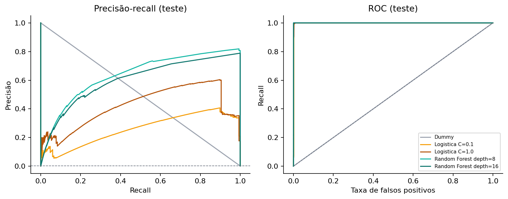

# ColdCard - ML

Trabalho da disciplina **Blockchain-2S2026**.

**Lucas Panonko Assis Belchior - 12311BCC068**

O objetivo é comparar modelos de aprendizado de máquina para identificar transações
associadas ao caso ColdCard apresentado na atividade. Os exemplos positivos são as
transações com alguma saída para o endereço de coleta informado no enunciado:

```text
bc1qnk4zh9qcnap2mycp56qjrgza3cc8ylrh8fecp0
```

Esse endereço serve para criar os rótulos, mas não é usado como entrada dos modelos.
As outras transações são negativas de referência; isso não garante que sejam legítimas.

## Organização

```text
src/          extração dos dados, treinamento, avaliação e geração do PDF
tests/        testes dos cálculos, das partições e da predição
data/         blocos originais e tabelas derivadas (não versionados)
results/      métricas, predições, erros, modelo salvo e gráficos
report/       relatório final em PDF
```

O relatório está em [report/ColdCard_ML_Lucas_Belchior.pdf](report/ColdCard_ML_Lucas_Belchior.pdf).
Ele inclui uma capa e quatro páginas de resultados e explicações visuais. O código e
os artefatos também ficam incorporados ao PDF, para atender à entrega em arquivo único.

## Como executar

Foi utilizado **Python 3.12**. A partir da raiz do projeto:

```bash
python -m venv .venv
```

Ative o ambiente criado (`.venv\Scripts\activate` no Windows ou
`source .venv/bin/activate` no Linux/macOS) e instale as dependências:

```bash
python -m pip install -r requirements.txt
```

Coloque o `blocos.tgz` da atividade em `data/`. Depois execute:

```bash
python -m src.extract_data
python -m src.train_models
python -m src.build_report
```

Para conferir os testes:

```bash
python -m unittest discover -s tests -v
```

Os gráficos e as métricas são recriados em `results/`. O bloco original não está
no Git; o arquivo esperado e seu hash estão descritos em [data/README.md](data/README.md).

## Como foi feito

1. Ler os 98 blocos e excluir as transações coinbase.
2. Marcar os envios ao coletor e extrair 35 atributos por transação: quantidades,
   tamanhos, valores, taxas e características dos scripts.
3. Separar blocos inteiros entre desenvolvimento e teste, sem compartilhar o mesmo bloco.
4. Comparar Dummy, regressão logística e Random Forest usando três divisões de validação.
5. Escolher a configuração pela média de **Average Precision (AP)** da validação
   e avaliar todos os candidatos no mesmo teste reservado.

Foram usados `log1p` em 16 atributos e padronização na regressão logística. A
padronização é ajustada somente no treino de cada divisão. Não entram nos atributos
os endereços, hashes, alturas, horários ou informações futuras de gasto das saídas.

Como existem positivos em apenas oito blocos, a distribuição das partições equilibra
o número de positivos e o total de transações. As sementes são 42 e 43. O limiar de
classificação foi mantido em 0,5, sem ajuste a partir do teste.

## Resultados

A base tem **493.473 transações elegíveis**, sendo **504 positivas**. O coletor
recebeu **594,47725695 BTC** nessas transações. O teste contém 123.255 transações,
das quais 168 são positivas.

| Modelo | AP média na validação | Precisão no teste | Recall no teste | F1 no teste | AP no teste |
|---|---:|---:|---:|---:|---:|
| Dummy | 0,0009 | 0,00% | 0,00% | 0,0000 | 0,0014 |
| Logística C=0,1 | **0,4723** | 21,66% | 99,40% | 0,3557 | 0,2597 |
| Logística C=1,0 | 0,4635 | 24,06% | 99,40% | 0,3875 | 0,4188 |
| Random Forest, profundidade 8 | 0,4273 | 81,07% | 99,40% | 0,8930 | 0,6705 |
| Random Forest, profundidade 16 | 0,3792 | 14,29% | 2,98% | 0,0493 | 0,6311 |

A configuração escolhida foi a **logística C=0,1**, pois teve maior AP média na
validação. No teste, encontrou 167 positivas, perdeu uma e gerou 604 falsos alarmes.
A Random Forest com profundidade 8 foi melhor nesse teste, mas trocar o modelo
depois de ver esse resultado usaria o teste para selecionar a configuração.



As métricas completas, resultados de cada divisão, configurações, versões e listas
de blocos estão em [results/results.json](results/results.json).

## Limitações

- As 168 positivas do teste principal pertencem ao mesmo bloco, de altura 960190.
  Isso limita o que se pode concluir sobre outros períodos ou ataques.
- A AP da logística selecionada variou bastante entre as três divisões: média
  0,4723 e desvio padrão amostral 0,3985. Esse desvio não é um intervalo de confiança.
- O diagnóstico temporal é exploratório e contém apenas um positivo. Sua configuração
  já havia sido escolhida na validação agrupada.
- A verificação de endereços de entrada compartilhados não identifica pessoas ou carteiras.
- O rótulo depende do coletor conhecido e da hipótese do exercício. Os blocos fornecidos
  não são uma amostra de toda a blockchain e não foram conferidos em um nó independente.

O resultado indica padrões úteis neste recorte, com muitos falsos alarmes no modelo
selecionado. Não demonstra um detector geral de roubos nem de transações de hardware wallets.

## Predição com o modelo salvo

```bash
python -m src.predict_saved data/transactions.csv.gz results/selected_model.joblib results/scored.csv.gz
```

O modelo salvo inclui os nomes dos atributos, a lista das transformações e o limiar.
O script de predição aplica as mesmas transformações usadas no treinamento. Os escores
não foram calibrados como probabilidades reais de roubo.

## Referências

- [Scikit-learn: seleção e avaliação de modelos](https://scikit-learn.org/stable/model_selection.html).
- [Scikit-learn: métricas de classificação](https://scikit-learn.org/stable/modules/model_evaluation.html).
- [Scikit-learn: cuidados com vazamento de dados](https://scikit-learn.org/stable/common_pitfalls.html).

Dados e regra de rotulação: enunciado e arquivo fornecidos na atividade ColdCard.
